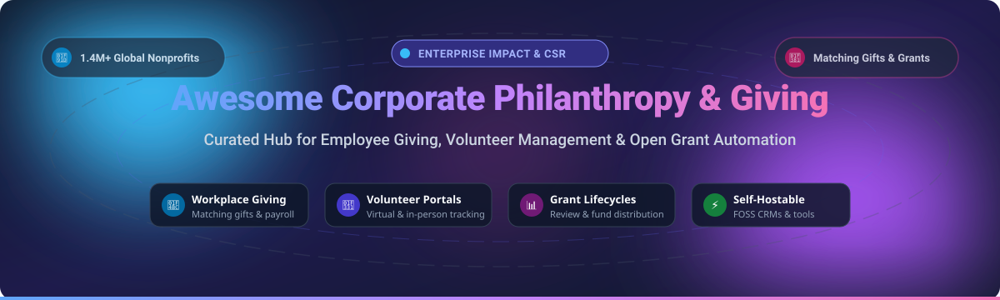
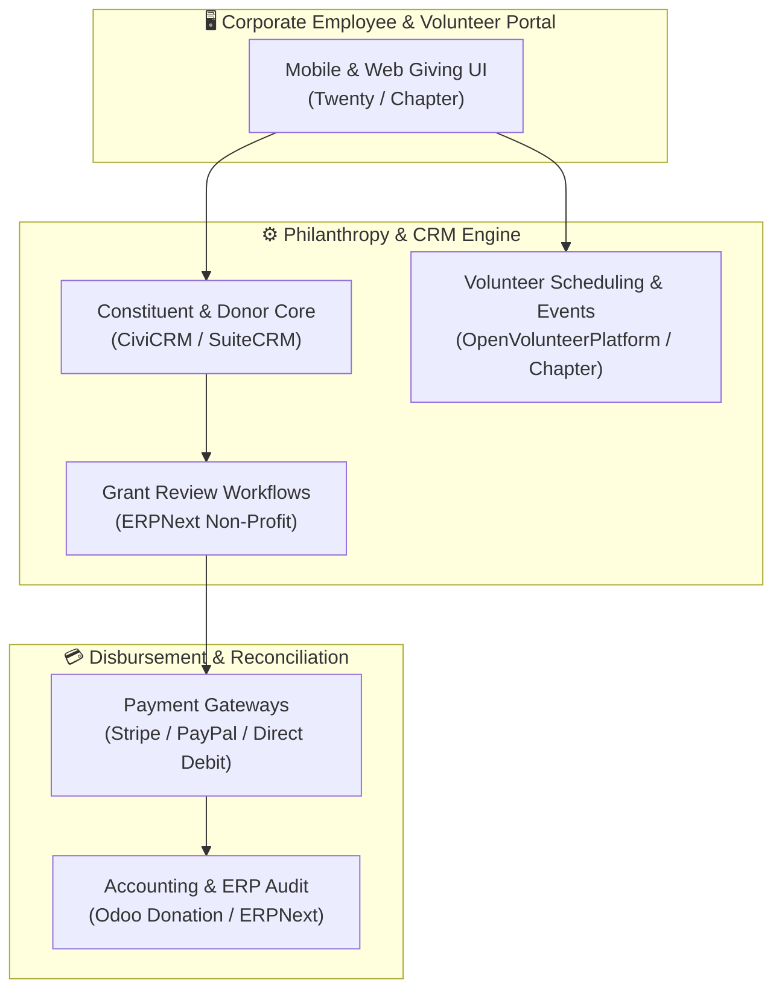

# 🌟 Awesome Corporate Philanthropy & Giving

  
  
  
  
  

  <strong>The Definitive Directory of Enterprise CSR SaaS Platforms &amp; Open-Source Philanthropy Software</strong> 
  <em>Empowering employee giving, volunteer management, donation matching, and grant lifecycle automation worldwide.</em>

  📅 <em>Last updated: October 2026</em>

---

## 📖 Executive Summary & Scope

Corporate Philanthropy and Giving technology empowers modern organizations to scale corporate social responsibility (CSR), employee volunteerism, corporate gift matching, and foundation grantmaking. Whether you are an enterprise CSR executive searching for compliant global donation disbursement networks or an NGO / software architect building self-hosted giving infrastructure, this repository curates the leading **enterprise SaaS platforms** and **active open-source GitHub ecosystems**.

### 🔑 Key Focus Areas
- 💼 **Workplace Giving & Donation Matching:** Automated payroll deductions, double-the-donation matching, and tax-exempt disbursement.
- 🤝 **Employee Volunteer Management:** Virtual, hybrid, and skills-based volunteer opportunity boards and attendance tracking.
- 📜 **Grant Lifecycle Automation:** Concealed peer reviews, eligibility vetting, disbursement tracking, and audit workflows.
- 🛡️ **Global Compliance & Vetting:** Sanctions screening, continuous 501(c)(3) / international NGO validation, and anti-fraud controls.
- 🔓 **Open-Source Transparency:** Self-hosted CRMs, donor management modules, and auditable grant frameworks.

---

## 📑 Table of Contents

- [📈 Sector Overview & Market Dynamics](#-sector-overview--market-dynamics)
- [☁️ SaaS/Hosted Platforms](#️-saashosted-platforms)
- [🔓 Open-Source GitHub Projects](#-open-source-github-projects)
- [🛠️ Architectural Blueprints for Custom Stacks](#️-architectural-blueprints-for-custom-stacks)
- [🤝 How to Contribute](#-how-to-contribute)
- [⭐ Star History](#--star-history)
- [💖 Support & Sponsorship](#-support--sponsorship)
- [⚖️ Disclaimer](#️-disclaimer)

---

## 📈 Sector Overview & Market Dynamics

The global corporate philanthropy, workplace giving, and CSR software sector represents an estimated market size of **$1.1B – $1.2B** (projected to exceed **$2.0B+** by the early 2030s at an estimated 9%–10% CAGR), operating alongside a broader nonprofit technology ecosystem exceeding **$4.9B**. 

### 🌐 Market Fragmentation Analysis
* **Enterprise Concentration:** The mega-enterprise tier is heavily concentrated among category giants (**Salesforce**, **Blackbaud / YourCause**, and private-equity rollups like **Benevity** and **Bonterra / CyberGrants**). These platforms dominate Fortune 500 accounts due to high switching costs, multi-national banking integrations, and complex compliance engines covering 200+ jurisdictions.
* **Mid-Market & Long-Tail Fragmentation:** Beyond the top echelon, the broader space remains **moderately to highly fragmented**. Agile SaaS innovators (such as **Millie**, **Submittable**, and **Goodera**) capture mid-market adoption with modern UX, Slack integrations, and curated experiential volunteering.
* **The Self-Hosted Shift:** Because enterprise CSR tools carry substantial recurring seat fees and processing overhead, foundations and privacy-sensitive international nonprofits increasingly adopt open-source CRM and donation primitives (**Twenty**, **ERPNext**, **CiviCRM**, and **SuiteCRM**) to retain sovereign control of donor records and grant scoring.

---

## ☁️ SaaS/Hosted Platforms

| 🏢 Platform | 📊 Company Size (Revenue / Valuation) | 💳 Pricing (Starting Tier) | 🎁 Free Tier / Trial Limits | 📝 Overview & Core Strengths |
| :--- | :--- | :--- | :--- | :--- |
| **[Salesforce Philanthropy Cloud](https://www.salesforce.org/)** | ~$200B+ Market Cap ($41.5B FY26 Rev) | Starts at **$60/user/month** (Enterprise Edition) | **30-day free trial** (Full test sandbox with sample data); **10 free core licenses** for eligible 501(c)(3)s via Power of Us | Flagship enterprise corporate impact platform built with United Way. Connects employees to 1.4M+ nonprofits with AI-driven recommendations via Salesforce Einstein. |
| **[YourCause by Blackbaud](https://www.yourcause.com/)** | ~$2.0B Market Cap ($1.18B Rev) | Custom enterprise contracts starting at **~$15,000/year** | **No corporate free trial**; **Free forever** for registered charities on YourCause Nonprofit Vetting Portal | High-security CSR platform featuring integrated grantmaking, disaster response campaigns, 7.5M+ nonprofits, 26 languages, and SOC 1/2 Type 2 compliance. |
| **[Benevity](https://benevity.com/)** | $1.1B+ Valuation (~$150M–$190M Rev) | Tiered enterprise contracts starting at **~$12,000/year** + 2–3% donation fees | **No corporate free trial** (Guided live sandbox demo only); **Free forever** profile and vetting on Benevity Causes Portal | Enterprise Impact Platform unifying employee giving, volunteering, and grants management with automated sanctions screening and Match Assurance across 200+ countries. |
| **[Alaya by Benevity](https://benevity.com/)** | $1.1B+ Valuation (Part of Benevity) | Integrated into core Benevity platform contracts | **No corporate free trial** (Consultative demo only); **Free** for registered community partners | European-born employee engagement and volunteering platform unified into Benevity's core product suite to drive grassroots corporate volunteering. |
| **[CyberGrants](https://www.cybergrants.com/)** | $1.0B+ Backing (Bonterra Ecosystem) | Starts at **~$4,000/year** (plus implementation & setup) | **No corporate free trial** (Custom guided sandbox upon request); **Free forever** for nonprofits via Bonterra FrontDoor | Comprehensive grant management and corporate employee giving suite used by global corporations and federal regulators (e.g. NCUA) for end-to-end grant lifecycles. |
| **[Submittable](https://www.submittable.com/)** | ~$500M–$1B Est. Valuation (~$33M–$66M Rev) | Starts at **~$3,000/year** (Annual Starter Plan) | **No admin free trial** (Guided consultative demo); **Free forever** for submitters and grant applicants to submit and track applications | Flexible submission and grant management platform with blinded/concealed reviews for bias reduction, scoring rubrics, and automated applicant fund distribution. |
| **[Bright Funds (Submittable)](https://www.yourcause.com/)** | ~$500M–$1B (Submittable subsidiary) | Starts at **~$2/employee/month** (~$2,400/year minimum) | **14-day free trial** on select standard corporate plans; **Free** fund receipting profile for verified 501(c)(3) nonprofits | All-in-one workplace giving and volunteering portal featuring instant donation matching, curated cause funds, volunteer hour tracking, and Microsoft Teams integration. |
| **[Goodera](https://www.goodera.com/)** | ~$25M–$29M Raised (Private) | Starts at **~$5/user/month** (Custom event & module packaging) | **No corporate free trial** (Platform demo on request); **Free forever** for 50,000+ registered non-profit partner hosts | Global volunteering platform operating curated in-person, hybrid, and virtual volunteering events with turnkey logistics, 24/7 host support, and real-time CSR metrics. |
| **[Deed](https://www.deed.com/)** | ~$13.1M Raised (Series A, acquired by Bonterra) | Custom subscriptions starting at **~$5,000/year** + partner fees | **No corporate free trial** (Guided demo available); **Free profile & tax receipting** for nonprofits via PayPal Giving Fund & GlobalGiving | Consumer-grade, gamified social impact platform designed for high employee engagement, instant donation matching, and employee-led volunteering initiatives. |
| **[Millie](https://www.millie.com/)** | ~$1.1M–$5M ARR (Early Stage PBC) | Headcount-based starting at **~$9,101/year** (for 100 seats) + 1.5% DAF fee | **No self-serve trial** (Interactive real-time proposal & pricing calculator); **Free forever** for registered 501(c)(3) charities | Accessible, lightweight workplace philanthropy platform tailored for mid-market teams, featuring zero-markup giving and native Slack integration. |

---

## 🔓 Open-Source GitHub Projects

Below are top open-source projects for constituent relationship management (CRM), grant tracking, donation processing, and volunteer coordination, ranked in descending order by GitHub community Stars_Count:

| 📦 Repository & Link | ⭐ GitHub_Stars (Sorted Descending) | 📜 License | 🎯 Category / Capabilities |
| :--- | :--- | :--- | :--- |
| **[twentyhq/twenty](https://github.com/twentyhq/twenty)** |  | AGPL-3.0 | Modern CRM alternative to Salesforce with clean GraphQL/REST APIs, customizable data pipelines for donor tracking, and enterprise-grade self-hosting. |
| **[frappe/erpnext](https://github.com/frappe/erpnext)** |  | GPL-3.0 | Full enterprise ERP featuring a dedicated **Non Profit Module** with donor management, membership handling, grant lifecycle tracking, and accounting integration. |
| **[SuiteCRM/SuiteCRM](https://github.com/salesagility/SuiteCRM)** |  | AGPL-3.0 | Battle-tested open-source enterprise CRM easily extensible with custom workflows for corporate philanthropy matching, volunteer databases, and grant approvals. |
| **[espocrm/espocrm](https://github.com/espocrm/espocrm)** |  | AGPL-3.0 | Fast, lightweight CRM framework with modular entities for donor relationship management, event attendance, and volunteer coordination. |
| **[freeCodeCamp/chapter](https://github.com/freeCodeCamp/chapter)** |  | BSD-3-Clause | Community and chapter event platform empowering local volunteer coordination, meetups, attendee RSVPs, and member engagement without commercial fees. |
| **[ChurchCRM/CRM](https://github.com/ChurchCRM/CRM)** |  | MIT | Full-featured community and giving CRM with built-in donation tracking, volunteer rostering, pledge processing, and family/constituent databases. |
| **[civicrm/civicrm-core](https://github.com/civicrm/civicrm-core)** |  | AGPL-3.0 | The gold standard open-source CRM built explicitly for nonprofits, advocacy groups, and charities. Features donor pledges, grant applications, and volunteer scheduling. |
| **[freeCodeCamp/pantry-for-good](https://github.com/freeCodeCamp/pantry-for-good)** |  | GPL-3.0 | Open-source food bank and charity logistics tool managing volunteer delivery routing, inventory distribution, client intake, and corporate donation scheduling. |
| **[karmacircleCommunity/KarmaCircle](https://github.com/karmacircleCommunity/KarmaCircle)** |  | GPL-3.0 | Collaborative platform connecting NGOs, volunteer changemakers, and donors to track and coordinate social initiatives and community impact. |
| **[impress-org/givewp](https://github.com/impress-org/givewp)** |  | GPL-3.0 | Widely deployed open-source donation and fundraising engine supporting recurring donations, donor goals, custom giving forms, and multiple payment gateways. |
| **[Giveth/giveth-dapp](https://github.com/Giveth/giveth-dapp)** |  | GPL-3.0 | Transparent blockchain-based philanthropic donation and grant distribution dApp with automated milestone-based payouts and zero middleman fees. |
| **[Teplitsa/Leyka](https://github.com/Teplitsa/Leyka)** |  | GPL-2.0 | Crowdfunding, donation management, and financial reporting framework for non-governmental organizations and philanthropic campaigns. |
| **[aerogear/OpenVolunteerPlatform](https://github.com/aerogear/OpenVolunteerPlatform)** |  | Apache-2.0 | Mobile-friendly workforce and volunteer dispatching system built for charity operations and municipal volunteer response. |
| **[OCA/vertical-ngo](https://github.com/OCA/vertical-ngo)** |  | AGPL-3.0 | Suite of specialized Odoo modules maintained by the Odoo Community Association for NGOs, covering donor memberships, project tracking, and grant operations. |
| **[moduon/donation](https://github.com/moduon/donation)** |  | AGPL-3.0 | Modular donation engine for Odoo ERP supporting direct debit mandate generation, recurring donations, and automated accounting reconciliation. |

---

## 🛠️ Architectural Blueprints for Custom Stacks

Organizations seeking to avoid vendor lock-in or high SaaS subscription markups can compose their own secure, enterprise-grade giving stack using open-source primitives:

1. **Constituent & Donor Core:** Deploy **CiviCRM** or **Twenty** as the centralized database for tracking employee contributions, matching limits, and vetted NGO partners.
2. **Volunteer Scheduling:** Integrate **Chapter** or **OpenVolunteerPlatform** for volunteer discovery, shift RSVPs, and automated attendance certification.
3. **Grant Workflow Management:** Leverage **ERPNext Non-Profit** to run multi-stage application review rounds, scorecards, and milestone-based grant approvals.
4. **Financial Reconciliation:** Connect **Odoo Donation (OCA)** and payment webhooks to automate banking disbursement, receipt generation, and general ledger synchronization.

---

## 🤝 How to Contribute

Contributions from CSR practitioners, open-source maintainers, and non-profit leaders are warmly welcomed! 

1. 🍴 **Fork the repository** to your GitHub profile.
2. 🌿 **Create a descriptive branch:** `git checkout -b feature/add-new-giving-tool`
3. ✏️ **Add your platform or project:**
   - For SaaS tools: include verified starting tier pricing, free tier/trial limits, and corporate scale.
   - For Open-Source projects: provide the repository link, Stars_Badge, license, and primary capabilities.
4. 🧪 **Check formatting:** ensure alphabetical or sorted consistency and verify markdown table links.
5. 🚀 **Submit a Pull Request (PR)** with a concise summary of why the tool should be added.

---

## ⭐ Star History

---

## 💖 Support & Sponsorship

Thank you for visiting and supporting the **Awesome Corporate Philanthropy & Giving** ecosystem! 🎉 

If this curated repository saved your team research time, provided architectural guidance, or helped you discover open-source social impact tooling:
- ⭐ **Star this repository** to increase visibility and help others find it.
- 🍴 **Fork and share** with colleagues in CSR, HR, and nonprofit engineering circles.
- ☕ **Buy a coffee & support ongoing maintenance:** Visit the [GitHub Sponsors Dashboard](https://github.com/sponsors/ishandutta2007) to sponsor the maintainer!

---

## ⚖️ Disclaimer

- This repository is a community-curated, educational index. Mentions of vendors, trademarks, or projects do not constitute commercial endorsement.
- Philanthropy platforms processing personal records, employee tax deductions, and financial transactions must adhere strictly to regional data privacy and financial compliance frameworks (GDPR, CCPA, SOC 2, PCI-DSS).
- Self-hosted open-source software requires routine security audits, continuous vulnerability patching, and secure key management for payment and disbursement gateways.

---

  Maintained with ❤️ for CSR professionals, foundation managers, nonprofit technologists, and open-source advocates.

